<h3><code>wiliam@github ~ $ ./contribuicoes.sh</code></h3>

  

<h3><code>wiliam@github ~ $ whoami</code></h3>
<table>
  <tr>
    <td valign="top"></td>
    <td valign="top"></td>
  </tr>
</table>

 

<h3><code>wiliam@github ~ $ cat contato.txt</code></h3>
<code><a href="mailto:wiliam.bonetti@gmail.com">e-mail</a></code> ·
<code><a href="https://www.linkedin.com/in/SEU_LINKEDIN">linkedin</a></code> ·
<code><a href="https://github.com/SEU_USUARIO?tab=repositories">repositórios</a></code>

